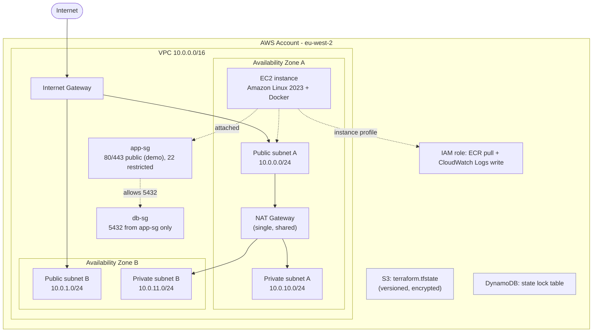

# AWS Infrastructure as Code with Terraform


> Portfolio project. No AWS account is deployed from this repository as-is —
> it demonstrates the Terraform module design, remote-state setup and CI
> gating a real environment would use.

## Purpose

This repository is the code behind the CV bullet:

> **AWS Infrastructure as Code with Terraform** — Provisioned a VPC, public
> and private subnets, security groups, EC2 and IAM roles using reusable
> Terraform modules, with remote state in S3 and DynamoDB state locking.
> Added `terraform fmt`, `validate` and `plan` checks to pull requests via
> GitHub Actions so infrastructure changes are reviewed before applying.

Every piece of that sentence maps to something concrete in this repo:

| CV bullet phrase | Where it lives |
|---|---|
| VPC, public/private subnets | [`modules/vpc`](modules/vpc) |
| Security groups | [`modules/security-groups`](modules/security-groups) |
| EC2 | [`modules/ec2`](modules/ec2) |
| IAM roles | [`modules/iam`](modules/iam) |
| Reusable Terraform modules | [`modules/`](modules) wired together in [`environments/dev`](environments/dev) |
| Remote state in S3 + DynamoDB locking | [`environments/dev/backend.tf`](environments/dev/backend.tf), bootstrapped by [`bootstrap/`](bootstrap) |
| `fmt`/`validate`/`plan` on PRs via GitHub Actions | [`.github/workflows/terraform-ci.yml`](.github/workflows/terraform-ci.yml) |

## Architecture



The EC2 instance in this example sits in a public subnet for simplicity (no
ALB in front of it). Private subnets + NAT Gateway are provisioned and
wired up by `modules/vpc` regardless, ready for a database tier, an ALB
target group, or ECS/EKS worker nodes to be added behind them.

## Repository layout

```
.
├── modules/
│   ├── vpc/                 # VPC, subnets, IGW, NAT, route tables
│   ├── security-groups/     # app-tier + db-tier security groups
│   ├── ec2/                 # EC2 instance, latest AL2023 AMI, user_data
│   └── iam/                 # least-privilege EC2 role + instance profile
├── environments/
│   └── dev/                 # root module wiring the above together
├── bootstrap/                # one-time: creates the S3 bucket + DynamoDB table
├── .github/workflows/
│   └── terraform-ci.yml     # fmt / validate / plan on every PR
├── LICENSE
└── README.md
```

## Modules

### `modules/vpc`

VPC with one public + one private subnet per AZ, an Internet Gateway, and
either a single shared NAT Gateway or one NAT Gateway per AZ.

| Variable | Type | Default | Description |
|---|---|---|---|
| `environment` | `string` | — | Environment name, used for naming/tagging. |
| `vpc_cidr` | `string` | `"10.0.0.0/16"` | CIDR block for the VPC. |
| `az_count` | `number` | `2` | Number of AZs to spread subnets across (1-6). |
| `public_subnet_cidrs` | `list(string)` | `["10.0.0.0/24", "10.0.1.0/24"]` | CIDRs for public subnets, one per AZ. |
| `private_subnet_cidrs` | `list(string)` | `["10.0.10.0/24", "10.0.11.0/24"]` | CIDRs for private subnets, one per AZ. |
| `enable_nat_gateway` | `bool` | `true` | Whether to provision NAT Gateway(s) for private subnet egress. |
| `single_nat_gateway` | `bool` | `true` | One shared NAT Gateway vs. one per AZ. |
| `tags` | `map(string)` | `{}` | Extra tags merged into every resource. |

| Output | Description |
|---|---|
| `vpc_id` | ID of the VPC. |
| `vpc_cidr_block` | CIDR block of the VPC. |
| `public_subnet_ids` | IDs of the public subnets. |
| `private_subnet_ids` | IDs of the private subnets. |
| `nat_gateway_ids` | IDs of the NAT Gateway(s). |
| `availability_zones` | AZs used by this VPC's subnets. |

### `modules/security-groups`

An app/web tier security group (80/443 inbound — public for demo purposes,
or scoped to an ALB security group; 22 restricted to a CIDR) and a database
tier security group (inbound only from the app tier, on `database_port`).

| Variable | Type | Default | Description |
|---|---|---|---|
| `environment` | `string` | — | Environment name, used for naming/tagging. |
| `vpc_id` | `string` | — | VPC to create the security groups in. |
| `allowed_ssh_cidr` | `string` | — | CIDR allowed to SSH into the app tier. Validated as a real CIDR. |
| `allow_public_http_https` | `bool` | `true` | Open 80/443 to `0.0.0.0/0` (demo-only, no ALB in this project). |
| `alb_security_group_id` | `string` | `null` | If set, scope 80/443 to this ALB security group instead. |
| `app_port` | `number` | `8080` | Documented app listening port (not opened by default). |
| `database_port` | `number` | `5432` | Port the db tier listens on; only reachable from the app tier. |
| `tags` | `map(string)` | `{}` | Extra tags merged into every resource. |

| Output | Description |
|---|---|
| `app_security_group_id` | ID of the app/web tier security group. |
| `db_security_group_id` | ID of the database tier security group. |

### `modules/iam`

Least-privilege IAM role for EC2 instances: read-only ECR image pull +
CloudWatch Logs write, nothing else, plus the instance profile that attaches
it to an instance. No `*FullAccess` managed policies are used.

| Variable | Type | Default | Description |
|---|---|---|---|
| `environment` | `string` | — | Environment name, used for naming/tagging. |
| `ecr_repository_arns` | `list(string)` | `[]` | ECR repos the role may pull from (`[]` = any repo, still read-only). |
| `cloudwatch_log_group_arns` | `list(string)` | `[]` | Log groups the role may write to (`[]` = any, still write-only). |
| `additional_managed_policy_arns` | `list(string)` | `[]` | Extra managed policies to attach, on top of the built-in ones. |
| `tags` | `map(string)` | `{}` | Extra tags merged into every resource. |

| Output | Description |
|---|---|
| `role_arn` | ARN of the EC2 IAM role. |
| `role_name` | Name of the EC2 IAM role. |
| `instance_profile_name` | Name of the instance profile (pass into `modules/ec2`). |
| `instance_profile_arn` | ARN of the instance profile. |

### `modules/ec2`

A single EC2 instance (see the in-code comment in `variables.tf` for how to
extend this to an Auto Scaling Group + launch template) on the latest
Amazon Linux 2023 AMI, resolved via an `aws_ami` data source, with Docker
installed via `user_data` and IMDSv2 enforced.

| Variable | Type | Default | Description |
|---|---|---|---|
| `environment` | `string` | — | Environment name, used for naming/tagging. |
| `instance_type` | `string` | `"t3.micro"` | EC2 instance type. |
| `subnet_id` | `string` | — | Subnet to launch into. |
| `security_group_ids` | `list(string)` | — | Security groups to attach. |
| `key_name` | `string` | `null` | EC2 key pair for SSH; `null` to launch without one. |
| `associate_public_ip` | `bool` | `true` | Assign a public IP (only meaningful in a public subnet). |
| `iam_instance_profile_name` | `string` | `null` | Instance profile name, typically `modules.iam.instance_profile_name`. |
| `root_volume_size` | `number` | `20` | Root EBS volume size (GiB). |
| `root_volume_type` | `string` | `"gp3"` | Root EBS volume type. |
| `enable_detailed_monitoring` | `bool` | `false` | 1-minute CloudWatch monitoring. |
| `user_data` | `string` | `null` | Override the built-in Docker-install user_data script. |
| `tags` | `map(string)` | `{}` | Extra tags merged into every resource. |

| Output | Description |
|---|---|
| `instance_id` | ID of the EC2 instance. |
| `public_ip` | Public IP address (empty if none assigned). |
| `private_ip` | Private IP address. |
| `ami_id` | Resolved AMI ID (latest Amazon Linux 2023). |

**Design note:** `modules/ec2` does not create its own IAM role — it only
*consumes* an instance profile name. Role/permission design is centralised
in `modules/iam` so least-privilege policies stay in one reviewable place
rather than being duplicated per compute module.

## Tagging convention

`environments/dev/main.tf` builds a `local.common_tags` map
(`Project`, `Environment`, `Owner`, `ManagedBy`) and passes it into every
module's `tags` variable, which each module further merges with its own
`Environment`/`ManagedBy`/`Module` tags before applying it to resources.
The root module also sets `default_tags` on the `aws` provider as a
belt-and-suspenders backstop for any resource that forgets to merge tags
explicitly.

## Remote state & locking

`environments/dev/backend.tf` configures an S3 backend with DynamoDB
locking. Terraform backend blocks cannot read input variables, so the
bucket/key/region/table values are supplied at `init` time via a
`-backend-config` file:

```bash
cd environments/dev
cp backend.hcl.example backend.hcl   # edit with real values
terraform init -backend-config=backend.hcl
```

**Bootstrapping problem:** the S3 bucket and DynamoDB table referenced by
that backend don't exist yet, and Terraform can't create the backend it's
about to store its own state in. So they're created **once**, out-of-band,
by the standalone config in [`bootstrap/`](bootstrap) (local state, applied
by hand):

```bash
cd bootstrap
terraform init
terraform apply
```

See [`bootstrap/README.md`](bootstrap/README.md) for details. This mirrors
how real organisations handle the backend bootstrapping problem: a small,
rarely-touched, manually-applied config that exists outside the main
environment/module tree.

## CI: fmt / validate / plan on every PR

[`.github/workflows/terraform-ci.yml`](.github/workflows/terraform-ci.yml)
runs on every pull request touching `modules/**` or `environments/**`:

1. **`fmt`** — `terraform fmt -check -recursive`. No AWS access needed;
   always runs, always must pass.
2. **`validate`** — for each module and `environments/dev`:
   `terraform init -backend=false` then `terraform validate`. No AWS
   access needed either — this only checks internal HCL correctness
   (types, references, required arguments), not real infrastructure.
3. **`plan`** — only runs if the `AWS_ROLE_ARN` repository variable is
   set. Uses `aws-actions/configure-aws-credentials` with OIDC (no
   long-lived AWS keys stored in GitHub) to assume that role, runs
   `terraform init`/`plan` against the real S3 backend, and posts the plan
   output as a PR comment so reviewers see exactly what would change
   before anyone runs `terraform apply`.

To make the `plan` job live, configure these as repository (or
environment) **variables** (not secrets — they're not sensitive, OIDC
means no long-lived keys are involved):

| Variable | Purpose |
|---|---|
| `AWS_ROLE_ARN` | IAM role ARN the workflow assumes via OIDC. Must trust `token.actions.githubusercontent.com` scoped to this repo. |
| `AWS_REGION` | Region to plan against (defaults to `eu-west-2` if unset). |
| `TF_STATE_BUCKET` | The bucket created by `bootstrap/` (see its `state_bucket_name` output). |
| `TF_LOCK_TABLE` | The table created by `bootstrap/` (see its `lock_table_name` output). |

Without `AWS_ROLE_ARN` set, the `plan` job is skipped entirely — `fmt` and
`validate` still run and gate the PR with zero AWS access required, which
is why this repository's own CI can run green with no AWS account behind
it at all.

## Cost note

Applying `environments/dev` creates **billable** AWS resources. The
largest recurring line item by far is the **NAT Gateway** (hourly charge +
per-GB data processing, even at idle) — set `enable_nat_gateway = false` in
`terraform.tfvars` if you don't need outbound internet from the private
subnets, or keep `single_nat_gateway = true` (the default) to use one
shared NAT Gateway instead of one per AZ. EC2, EBS and Elastic IP (when
attached to a running NAT Gateway) also incur charges while running.

**Always run `terraform destroy` when you're done experimenting:**

```bash
cd environments/dev
terraform destroy
```

The S3 bucket and DynamoDB table created by `bootstrap/` are negligible
cost (a few KB of state, pay-per-request table) and are safe to leave
running between sessions — they hold no billable compute.

## Getting started (local, code-only)

```bash
# 1. One-time bootstrap of the remote state backend
cd bootstrap && terraform init && terraform apply

# 2. Configure the dev environment's backend + variables
cd ../environments/dev
cp backend.hcl.example backend.hcl           # fill in real bucket/table
cp terraform.tfvars.example terraform.tfvars # fill in your allowed_ssh_cidr etc.
terraform init -backend-config=backend.hcl

# 3. Review before applying anything
terraform fmt -check -recursive
terraform validate
terraform plan
```

This repository does not run `terraform apply` or any live AWS call as
part of building or validating it — `fmt`, `init -backend=false` and
`validate` require no AWS credentials at all.
